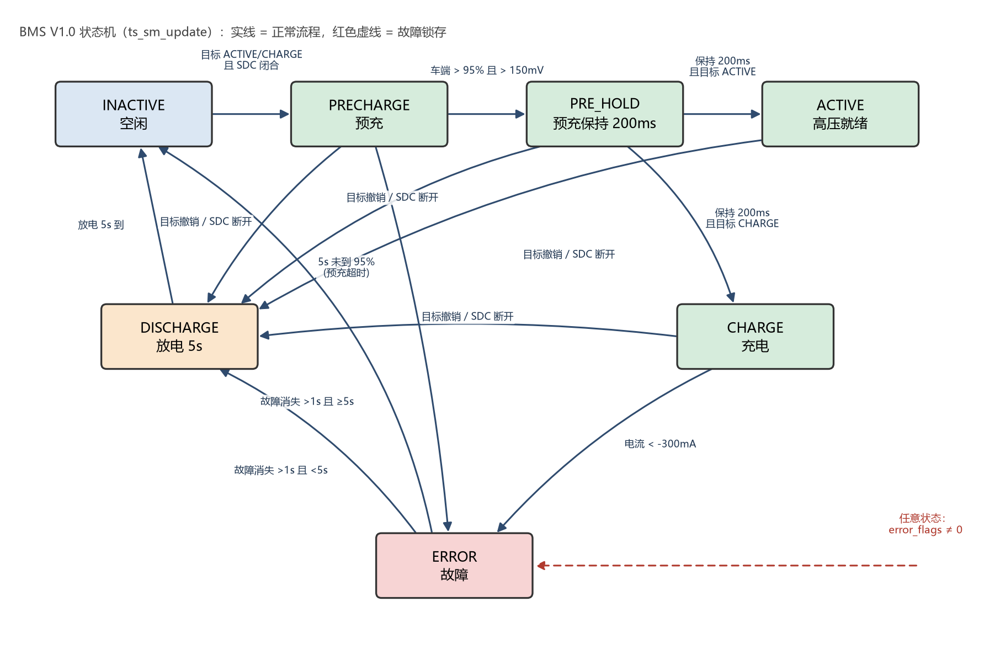
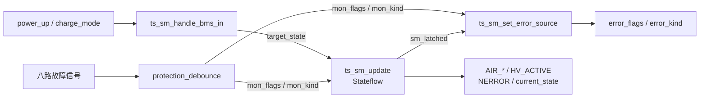
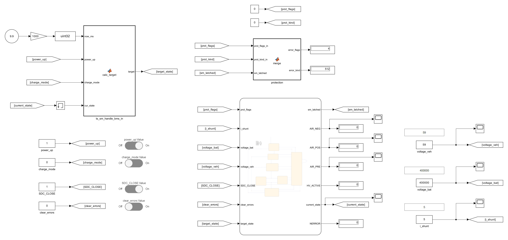
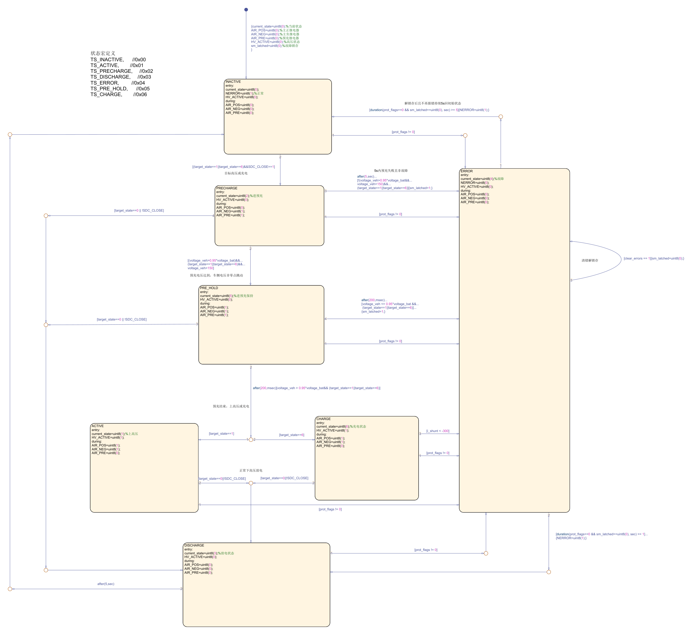

# BMS 应用层状态机模型

**基于模型设计（MBD）的电池管理系统控制逻辑建模与验证**

MATLAB R2025b · Simulink · Stateflow

---

## 1. 概述

本文档描述电池管理系统（BMS）应用层状态机的建模与验证工作。模型以
Simulink/Stateflow 为建模工具，对 `BMS_V1.0` 参考实现中的 `ts_sm_update()`
控制逻辑进行等价建模，用于控制策略的仿真验证与后续代码生成。

模型涵盖以下功能范围：

- 七状态有限状态机；
- 八路故障信号的去抖、锁存与故障分类；
- 预充电过程的电压判据与时序控制；
- 充电、放电及故障恢复流程。

模型仅包含应用层逻辑，不包含 SPI、CAN、GPIO 等驱动层实现，亦不包含非易失存储。



<div align="center"><sub>图 1　状态转移示意</sub></div>

---

## 2. 系统架构

模型由四个功能模块组成，模块划分与参考实现的函数划分一致，模块间通过信号线连接。



| 模块 | 功能 | 对应参考实现 |
|---|---|---|
| `protection_debounce` | 八路故障去抖、锁存与位图生成 | `error_monitor_update()` |
| `ts_sm_update` | 状态机主体（Stateflow） | `ts_sm_update()` |
| `ts_sm_handle_bms_in` | 由启动请求与充电请求计算目标状态 | `ts_sm_handle_bms_in()` |
| `ts_sm_set_error_source` | 故障源与状态机故障的合并 | `ts_sm_set_error_source()` |

图 2 为模型顶层结构（含测试用的 Dashboard 控件与观测模块）。



<div align="center"><sub>图 2　模型顶层结构</sub></div>

---

## 3. 状态定义与迁移

### 3.1 状态编码

| 编码 | 状态 | 说明 | AIR 主正/主负/预充 | HV_ACTIVE | NERROR |
|:--:|---|---|:--:|:--:|:--:|
| 0 | INACTIVE | 空闲 | 0 / 0 / 0 | 0 | 1 |
| 2 | PRECHARGE | 预充 | 0 / 1 / 1 | 0 | — |
| 5 | PRE_HOLD | 预充保持 | 1 / 1 / 1 | 0 | — |
| 1 | ACTIVE | 高压就绪 | 1 / 1 / 0 | 1 | — |
| 6 | CHARGE | 充电 | 1 / 1 / 0 | 1 | — |
| 3 | DISCHARGE | 放电等待 | 0 / 0 / 0 | 0 | — |
| 4 | ERROR | 故障 | 0 / 0 / 0 | 0 | 0 |

状态编码与参考实现的 `TSState` 枚举一致，用于 CAN 上报。

### 3.2 迁移条件

| 源状态 | 目标状态 | 条件 |
|---|---|---|
| INACTIVE | PRECHARGE | 目标状态为 ACTIVE 或 CHARGE，且 SDC 闭合 |
| PRECHARGE | PRE_HOLD | `veh > 150 mV` 且 `veh > 0.95 × bat` |
| PRECHARGE | ERROR | 持续 5 s 未满足上述判据 |
| PRE_HOLD | ACTIVE / CHARGE | 保持 200 ms 且电压判据仍成立 |
| PRE_HOLD | ERROR | 保持 200 ms 后电压判据不成立 |
| PRECHARGE / PRE_HOLD / ACTIVE / CHARGE | DISCHARGE | 目标状态撤销或 SDC 断开 |
| CHARGE | ERROR | 包电流 `< -300 mA` |
| DISCHARGE | INACTIVE | 持续 5 s |
| ERROR | DISCHARGE | 故障位清零并稳定 1 s |
| 任意状态 | ERROR | `mon_flags != 0` |

故障为锁存型：故障消失不自动清除，须由 `clear_errors` 指令复位。

图 3 为上述状态与迁移条件的 Stateflow 实现。



<div align="center"><sub>图 3　Stateflow 状态机实现</sub></div>

---

## 4. 接口规范

### 4.1 输入信号

| 信号 | 数据类型 | 单位 | 说明 |
|---|:--:|:--:|---|
| `now_ms` | uint32 | ms | 毫秒时间戳（仿真时由 `Clock × 1000` 生成） |
| `power_up` | 0/1 | — | 启动请求 |
| `charge_mode` | 0/1 | — | 充电机请求 |
| `SDC_CLOSE` | uint8 | — | 安全回路闭合状态 |
| `clear_errors` | uint8 | — | 故障清除指令（单次脉冲） |
| `voltage_bat` | int32 | mV | 电池包电压 |
| `voltage_veh` | int32 | mV | 车端电压 |
| `i_shunt` | int32 | mA | 包电流，充电方向为正 |
| `cell_ov` / `cell_uv` / `cell_ot` | 0/1 | — | 单体过压 / 欠压 / 过温 |
| `afe_comm` | 0/1 | — | AFE 通信错误 |
| `shunt_tmo` / `shunt_oc` | 0/1 | — | 分流器数据超时 / 过流 |
| `busbar_ot` / `v_mismatch` | 0/1 | — | 铜排过温 / 压差过大 |

### 4.2 输出信号

| 信号 | 数据类型 | 说明 |
|---|:--:|---|
| `current_state` | uint8 | 当前状态编码（0~6） |
| `AIR_POS` / `AIR_NEG` / `AIR_PRE` | uint8 | 继电器控制命令 |
| `HV_ACTIVE` | uint8 | 高压就绪指示 |
| `NERROR` | uint8 | 故障指示（低电平有效） |
| `error_flags` | uint16 | 故障源位图：bit0 单体、bit1 分流器、bit2 状态机 |
| `error_kind` | uint16 | 故障种类位图，见表 4.3 |

### 4.3 故障种类编码

| 位 | 值 | 含义 |
|:--:|:--:|---|
| 0 | 1 | 无故障 |
| 1 | 2 | 单体过压 |
| 2 | 4 | 单体欠压 |
| 3 | 8 | 单体过温 |
| 4 | 16 | 分流器数据超时 |
| 5 | 32 | 分流器过流 |
| 6 | 64 | 铜排过温 |
| 7 | 128 | 压差过大 |
| 8 | 256 | AFE 通信错误 |
| 9 | 512 | 预充超时 |

---

## 5. 参数配置

| 参数 | 取值 | 说明 |
|---|:--:|---|
| 预充超时 | 5000 ms | 超过该时间未达到判据则进入 ERROR |
| 预充电压判据 | `veh > 150 mV` 且 `veh > 0.95 × bat` | |
| 预充保持时间 | 200 ms | PRE_HOLD 驻留时间 |
| 放电等待时间 | 5000 ms | DISCHARGE 驻留时间 |
| 故障恢复时间 | 1000 ms | 故障位清零后的稳定时间 |
| 目标状态保持时间 | 500 ms | 启动请求撤销后 ACTIVE 的最长保持时间 |
| 故障去抖时间 | 1000 ms（单体）/ 500 ms（分流器） | |

---

## 6. 建模与仿真

模型以固定步长 0.15 s 仿真，与参考实现 150 ms 的控制周期对应。

```matlab
cd BMS_MBD
addpath('lib','scripts','models');
bms_mbd_types('Exported');        % 定义枚举与总线类型

open_system('models/bms.slx')
```

---

## 7. 验证

采用脚本化信号注入方式，对状态序列与故障输出进行自动比对。测试用例覆盖正常迁移、
边界判据与故障分支，共 16 项，全部通过。

```matlab
hil_suite(1:16)
```

| 序号 | 测试场景 | 结果 |
|:--:|---|:--:|
| 1 | 主流程、故障锁存与清除 | 通过 |
| 2 | 预充超时（`error_flags=4`，`error_kind=512`） | 通过 |
| 3 | 预充过程中撤销目标 | 通过 |
| 4 | 预充过程中 SDC 断开 | 通过 |
| 5 | PRE_HOLD 过程中撤销目标 | 通过 |
| 6 | PRE_HOLD 后电压跌落 | 通过 |
| 7 | 充电流程（进入 CHARGE） | 通过 |
| 8 | 充电电流反向 | 通过 |
| 9 | 电流 −300 mA 边界不触发 | 通过 |
| 10 | ACTIVE 状态下故障 | 通过 |
| 11 | 去抖时间不足（500 ms）不触发 | 通过 |
| 12 | 双故障源（`error_flags=3`） | 通过 |
| 13 | 上电即存在故障 | 通过 |
| 14 | 非 ERROR 状态下清除指令无副作用 | 通过 |
| 15 | 故障恢复后再次触发 | 通过 |
| 16 | 启动请求短时抖动下的状态保持 | 通过 |

`models/bms_replay.slx` 为数据回灌模型，通过 `replay_replay_sil()` 可与参考实现的
黄金数据逐拍对比。

---

## 8. 目录结构

```text
BMS_MBD/
├── models/          Simulink 模型
│   ├── bms.slx          状态机主模型
│   └── bms_replay.slx   数据回灌模型
├── lib/             类型定义与参考实现
│   ├── bms_mbd_types.m
│   ├── sm_state_machine.m
│   └── monitor_layer.m
├── scripts/         构建与测试脚本
│   ├── hil_suite.m      16 项自动测试
│   └── hil_test_bms.m   单场景测试
├── docs/            设计文档
│   ├── bms_state_machine.md
│   ├── bms_state_machine.png
│   └── sm_defs.h
└── host/            主机侧 C 参考工程
```

---

## 9. 限制与假设

1. 模型仅覆盖应用层逻辑，不包含驱动层与通信层；
2. 硬件级故障（继电器粘连、绝缘、互锁、AFE 断线）不在建模范围内；
3. AIR 继电器 10 ms 闭合间隔未建模（仿真步长 0.15 s）；
4. 串口控制与手动 AIR 测试模式未实现。

---

## 10. 参考

1. `BMS_V1.0/APP/Core/Src/state_machine.c`
2. [`docs/bms_state_machine.md`](docs/bms_state_machine.md)
