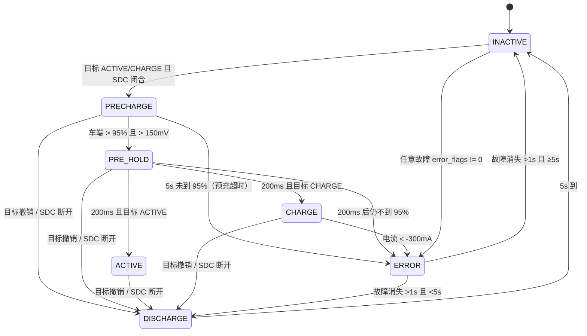

# BMS 状态机：流程图与转移条件

> 依据 `BMS_V1.0/APP/Core/Src/state_machine.c` 的 `ts_sm_update()` 整理，
> 也就是 `models/bms_replay.slx` 里 `状态机` 块实现的那套逻辑。
> 想自己搭一套的话，按本文的状态、转移条件、时间参数逐条实现即可。


## 1. 七个状态

| 状态 | 值 | 含义 | 三个 AIR 继电器（主正/主负/预充） | HV_ACTIVE | BMS_NERROR |
|---|---|---|---|---|---|
| INACTIVE | 0 | 空闲/停机 | 断 / 断 / 断 | 0 | 1（正常） |
| PRECHARGE | 2 | 预充中，等车端电压升到 95% | 断 / **合** / **合** | 0 | 保持 |
| PRE_HOLD | 5 | 预充完成，等待 200 ms | **合** / **合** / **合** | 保持 | 保持 |
| ACTIVE | 1 | 高压就绪（行车） | **合** / **合** / 断 | 1 | 保持 |
| CHARGE | 6 | 充电中 | **合** / **合** / 断 | 1 | 保持 |
| DISCHARGE | 3 | 放电，等 5 s 后回空闲 | 断 / 断 / 断 | 0 | 保持 |
| ERROR | 4 | 故障 | 断 / 断 / 断 | 0 | **0（故障灯亮）** |

说明：

- `BMS_NERROR` 低有效（0 = 故障灯亮）。只有 INACTIVE 会主动写高，ERROR 会写低并
  在恢复条件满足时写回高。
- AIR 继电器在每次状态确定后统一设置（`ts_sm_set_AIR_positions`）；闭合命令之间
  至少间隔 `air_close_wait_ms`（10 ms）。
- 状态值 0~6 与 `TSState` 枚举一致，CAN/遥测按这些原始值上报。

## 2. 每拍的执行顺序

```
ts_sm_update():
  1) 串口控制超时检查（control_mode != GPIO 且 >1s → 回 GPIO，target=INACTIVE）
  2) if (ts_state.error != 0) current = ERROR        // 故障锁存，优先于一切
  3) ts_sm_handle_bms_in()                            // 决定 target_state
  4) drive_mode_timeout_check()                       // 2s 无整车报文 → drive_mode=0
  5) switch(current) 调对应处理函数，返回值写回 current
  6) ts_sm_set_AIR_positions(current)                 // 按新状态设三个继电器
```

`target_state` 的来源（`ts_sm_handle_bms_in`）：

- `POWER_UP` 引脚高：
  - `charge_mode == 1`（充电机请求，且 1 s 内收到过 CCS 报文）→ **CHARGE**
  - 否则 → **ACTIVE**
- `POWER_UP` 引脚低：
  - 当前是 ACTIVE 且还没记时 → 记下 `state_convert_timestamp`，target 先保持 ACTIVE
  - 当前是 ACTIVE 且距记时 ≤ `max_state_hold_time_ms`(500 ms) → 保持 ACTIVE
  - 否则 → **INACTIVE**

## 3. 转移条件（完整表）

| # | 源状态 | 目标 | 条件 | 附带动作 |
|---|---|---|---|---|
| 1 | INACTIVE | PRECHARGE | `target ∈ {ACTIVE, CHARGE}` 且 `SDC 闭合` | 记 `precharge_start = now`，清 `precharge_95` |
| 2 | PRECHARGE | INACTIVE | **不可达**：C 里最后的 `return TS_INACTIVE` 是兜底，`target` 只可能是 0/1/6，而 0 已被 #4 拦成 DISCHARGE | — |
| 3 | PRECHARGE | PRE_HOLD | `target ∈ {ACTIVE, CHARGE}` 且 `车端电压 > 150 mV` 且 `车端 > 0.95 × 包压` | 记 `precharge_95 = now` |
| 4 | PRECHARGE | DISCHARGE | `target == INACTIVE` 或 `SDC 断开` | 记 `discharge_begin = now` |
| 5 | PRECHARGE | ERROR | 以上都不满足，且 `now - precharge_start ≥ 5000 ms`（预充超时） | 置 `error |= 4`、`error_kind |= 512`，拉低 NERROR |
| 6 | PRE_HOLD | DISCHARGE | `target == INACTIVE` 或 `SDC 断开` | 记 `discharge_begin = now` |
| 7 | PRE_HOLD | ACTIVE | `now - precharge_95 ≥ 200 ms` 且 `target == ACTIVE` 且 `车端 > 0.95 × 包压` | — |
| 8 | PRE_HOLD | CHARGE | `now - precharge_95 ≥ 200 ms` 且 `target == CHARGE` 且 `车端 > 0.95 × 包压` | — |
| 9 | PRE_HOLD | ERROR | `now - precharge_95 ≥ 200 ms` 且目标为 ACTIVE/CHARGE 但 `车端 ≤ 0.95 × 包压` | 同 #5 的置位 |
| 10 | PRE_HOLD | DISCHARGE | **不可达**：`target` 只可能是 0/1/6，0 已被 #6 拦住，1/6 走 #7/#8 | 记 `discharge_begin = now` |
| 11 | ACTIVE | DISCHARGE | `target == INACTIVE` 或 `SDC 断开` | 记 `discharge_begin = now`，HV_ACTIVE=0 |
| 12 | CHARGE | DISCHARGE | `target == INACTIVE` 或 `SDC 断开` | 记 `discharge_begin = now`，HV_ACTIVE=0 |
| 13 | CHARGE | ERROR | `包电流 < -300 mA`（充电时电流反向） | 返回 ERROR；NERROR 本拍不动，下一拍 ERROR 处理才拉低 |
| 14 | DISCHARGE | INACTIVE | `now - discharge_begin ≥ 5000 ms` | — |
| 15 | ERROR | DISCHARGE | `error_flags == 0` 且已稳定 `> 1000 ms` 且 `now - no_error_start < 5000 ms` | NERROR=1，记 `discharge_begin` |
| 16 | ERROR | INACTIVE | `error_flags == 0` 且已稳定 `> 1000 ms` 且 `now - no_error_start ≥ 5000 ms` | NERROR=1 |
| 17 | 任意状态 | ERROR | `error_flags != 0`（单体/分流器故障或预充超时） | 清 `no_error_start`，HV_ACTIVE=0 |

实现时最容易踩的三个点：

1. **故障是锁存的**：`error_flags` 只有 `clear_errors`（串口 CLEAR）能清，故障消失
   不会自动清位；ERROR 里要等 `error_flags == 0` 才开始 1 s 计时。
2. **预充超时置的是状态机自己的源**（flag 4 / kind 512），它不会随故障消失而清，
   必须 `clear_errors`。
3. **CHARGE 电流反向进 ERROR 时不动 NERROR**：C 只 `return TS_ERROR`，NERROR
   由下一拍的 ERROR 处理函数拉低；如果当拍就拉低，会与参考实现差一拍。

再补两个预充判据的细节（自己实现时容易漏）：

4. **PRECHARGE→PRE_HOLD 的三个条件**是 `target ∈ {ACTIVE, CHARGE}`、
   `veh > 150 mV`、`veh > 0.95 × bat`，缺一不可；进入时把 `precharge_95 = now`
   （200 ms 保持从这一刻开始），AIR 在同一拍变成三个全闭（主正合上）。
5. **PRE_HOLD 里会再查一次 95%**，但那次只比 `veh > 0.95 × bat`，**没有 150 mV
   下限**；不满足就按预充超时进 ERROR。
6. **`bat == 0` 时判据会退化**：`veh > 150 && veh > 0.95×0` 恒成立，等于车端电压
   一超过 150 mV 就“预充完成”。参考代码没防这个（靠分流器超时兜底），自己实现
   建议加一句 `bat > 0`。

## 4. 时间参数（`default_config`）

| 参数 | 默认值 | 用在哪 |
|---|---|---|
| `air_close_wait_ms` | 10 ms | 两个 AIR 闭合命令之间的最小间隔 |
| `precharge_95_wait_time_ms` | 5000 ms | 预充到 95% 的超时 |
| `pre_hold_time_ms` | 200 ms | 到 95% 后保持多久再进 ACTIVE/CHARGE |
| `discharge_duration_ms` | 5000 ms | DISCHARGE 保持时间 |
| `no_error_time_ms` | 1000 ms | ERROR 里故障消失后需稳定的时间 |
| `max_state_hold_time_ms` | 500 ms | POWER_UP 撤销后 ACTIVE 最多再保持多久 |
| `drive_mode_timeout_ms` | 2000 ms | 整车驱动报文超时 |
| `MIN_VEHICLE_SIDE_VOLTAGE` | 150 mV | 预充判据的绝对下限（硬件固定，不是配置项） |

预充完成判据：`v_veh > 150 mV && v_veh > 0.95 × v_bat`。

## 5. 故障位定义

`error_flags`（故障源，`ts_state.error`）：

| 位 | 值 | 来源 |
|---|---|---|
| 0 | 1 | 单体/从机侧（保护层） |
| 1 | 2 | 分流器侧（保护层） |
| 2 | 4 | 状态机自己（预充超时） |

`error_kind`（故障种类，可同时置多位）：

| 位 | 值 | 含义 |
|---|---|---|
| 0 | 1 | NONE（无故障） |
| 1 | 2 | 单体过压 |
| 2 | 4 | 单体欠压 |
| 3 | 8 | 单体过温 |
| 4 | 16 | 分流器数据超时 |
| 5 | 32 | 分流器过流 |
| 6 | 64 | 铜排过温 |
| 7 | 128 | 压差过大 |
| 8 | 256 | AFE 通信错误 |
| 9 | 512 | 预充超时 |

## 6. 伪代码（照着写就行）

```text
每 150 ms 调一次：

  if error_flags != 0: cur = ERROR

  if POWER_UP:
      target = (charge_mode ? CHARGE : ACTIVE)
  else if cur == ACTIVE and within 500 ms of first seeing POWER_UP low:
      target = ACTIVE
  else:
      target = INACTIVE

  switch cur:
    INACTIVE:
        NERROR = 1
        if target in {ACTIVE, CHARGE} and SDC:      → PRECHARGE (记 precharge_start)
        else                                        → INACTIVE

    PRECHARGE:
        if target == INACTIVE or !SDC:              → DISCHARGE (记 discharge_begin)
        elif target in {ACTIVE, CHARGE}:
            if v_veh > 150 and v_veh > 0.95*v_bat:  → PRE_HOLD (记 precharge_95)
            elif now - precharge_start >= 5000:     → ERROR (置 4/512, NERROR=0)
            else                                    → PRECHARGE
        else                                        → INACTIVE

    PRE_HOLD:
        if target == INACTIVE or !SDC:              → DISCHARGE (记 discharge_begin)
        elif now - precharge_95 >= 200:
            if target == ACTIVE:
                v_veh > 0.95*v_bat ? ACTIVE : ERROR(4/512)
            elif target == CHARGE:
                v_veh > 0.95*v_bat ? CHARGE : ERROR(4/512)
            else                                    → DISCHARGE
        else                                        → PRE_HOLD

    ACTIVE:
        HV_ACTIVE = 1
        if target == INACTIVE or !SDC:              → DISCHARGE (记 discharge_begin, HV=0)
        else                                        → ACTIVE

    CHARGE:
        HV_ACTIVE = 1
        if target == INACTIVE or !SDC:              → DISCHARGE (记 discharge_begin, HV=0)
        elif i_shunt < -300:                        → ERROR (不动 NERROR)
        else:                                       发充电请求; → CHARGE

    DISCHARGE:
        now - discharge_begin >= 5000 ? INACTIVE : DISCHARGE

    ERROR:
        HV_ACTIVE = 0
        if error_flags == 0:
            if no_error_start == 0: no_error_start = now
            elif now - no_error_start > 1000:
                NERROR = 1
                now - no_error_start < 5000 ? DISCHARGE(记 discharge_begin) : INACTIVE
        else:
            no_error_start = 0
        NERROR = 0; → ERROR

  最后按 cur 设置三个 AIR 继电器（见第 1 节表格）
```

## 7. Mermaid 版（可粘到支持 Mermaid 的编辑器里）



## 8. 最少变量版实现（用 delay 换掉一部分状态）

如果允许在状态机里用 `delay`，可以把 C 里的 5 个计时变量省掉。结论：

**必须常驻的（9 个）**

| 变量 | 类型 | 初值 | 作用 |
|---|---|---|---|
| `cur_state` | uint8 | INACTIVE | 当前状态 |
| `target_state` | uint8 | INACTIVE | 目标状态 |
| `error_flags` | uint16 | 0 | 故障源位图（锁存） |
| `error_kind` | uint16 | 1(NONE) | 故障种类位图 |
| `precharge_start` | uint32 | 0 | 预充开始时刻，判 5 s 超时 |
| `state_convert` | uint32 | 0 | POWER_UP 撤销的时刻，判 ACTIVE 保持 |
| `no_error_start` | uint32 | 0 | 故障消失的时刻，判 1 s 恢复 |
| `drive_mode` | uint8 | 0 | 驱动模式 |
| `last_vcu_ms` | uint32 | 0 | 最近一次收到整车报文的时刻 |

**用 delay 可以省掉的（5 个）**

| C 里的变量/状态 | 换成 | 说明 |
|---|---|---|
| `precharge_95_finished_timestamp` | `delay(200)` | 预充完成后是无条件等 200 ms，直接延时即可 |
| `discharge_begin_timestamp` | `delay(5000)` | DISCHARGE 是无条件等 5 s |
| `air_close_wait` 的 `last_close_timestamp` | `delay(10)` | 闭合命令前固定等 10 ms，不用记上次闭合时刻 |
| `pos_state/neg_state/pre_state` 三个 AIR 状态 | 读 GPIO 的 ODR/IDR | 判断继电器当前是不是已闭合，不用变量 |
| 状态机自己的时间基准 `now` | `HAL_GetTick()` | 随时读，不用存 |

省完就是 9 个静态变量；如果连驱动模式都不用，再减 2 个 = 7 个。

**不属于状态变量、但必须提供的输入**

这些是测量量/外部信号，每拍由别的模块刷新，状态机只读，所以不进上面的表：

| 输入 | 类型/单位 | BMS_V1.0 里的来源 |
|---|---|---|
| `v_bat_mv` 包电压 | int32, mV | `shunt_data.voltage_bat`（分流器报文 `CAN_ID_SHUNT_VOLTAGE_1`） |
| `v_veh_mv` 车端电压 | int32, mV | `shunt_data.voltage_veh`（`CAN_ID_SHUNT_VOLTAGE_2`） |
| `i_shunt_ma` 包电流 | int32, mA | `shunt_data.current`（CHARGE 判 −300 mA 用） |
| `sdc_closed` | bool | SDC 回路检测（GPIO/输入） |
| `power_up` | bool | 启动信号（GPIO/输入） |
| `charge_mode` | bool | 充电机请求（CCS 报文，已做 1 s 超时） |

要点：

- `shunt_data` 定义在 `shunt_monitor.h`，字段 `int32_t voltage_bat / voltage_veh`，
  单位 mV，上电初值 0；
- 状态机不判断数据新不新鲜——分流器超时由保护层置 `error_flags` 的
  `TS_ERROR_SOURCE_SHUNT`，状态机下一拍就进 ERROR；
- 上电时两个电压都是 0，预充判据 `veh > 150` 不成立，会一直预充到 5 s 超时进
  ERROR——这是安全侧行为，不要“优化”掉；
- 不想用全局变量的话，也可以把它们做成参数：
  `void sm_tick(int32_t v_bat_mv, int32_t v_veh_mv, int32_t i_ma)`。

**预充判据的两个电压到底从哪来**

```
分流器测量单元 ──CAN1──▶ ftcan_msg_received_cb()
                           └─ 0x522 → shunt_data.voltage_bat   (电池侧电压)
                           └─ 0x523 → shunt_data.voltage_veh   (车端电压)
                                     ts_sm_update_precharge() 读这两个值
```

- 都是**分流器**（独立测量盒）的电压采样通道，不是 AFE 的单体电压：
  - `voltage_bat` 接**电池侧**（主继电器之前，等于包压）；
  - `voltage_veh` 接**车端**（主继电器之后、负载/充电机侧）。
- 报文是 6 字节无符号，单位 mV（`ftcan_unmarshal_unsigned(&data, 6)`）。
- 预充时主继电器断开，预充继电器经电阻给车端电容充电，`voltage_veh` 从 0 往上爬；
  爬到 `> 0.95 × voltage_bat`（且 >150 mV）就算预充完成 → 合主正。
- 第三个通道 `voltage_x`（0x524）代码里有接收但状态机不用。
- 没有分流器时可以用“AFE 单体总压 + 车端采样”代替，但数值会和包压略有差别
  （单体总压通常比包压略低），95% 的门槛要按自己的传感器重新标。

**不建议用 delay 替代的 3 个**（它们不能省的原因）

| 计时 | 为什么不能直接 delay |
|---|---|
| 预充 5 s 超时 | 这 5 s 里要一直读车端/包电压判断是否到 95%，`delay(5000)` 会把判断也挡掉 |
| 故障恢复 1 s | 这 1 s 里要一直看 `error_flags` 有没有重新置位，delay 期间看不到 |
| ACTIVE 保持 500 ms | 这 500 ms 里仍要刷新输出、处理故障，delay 会把它们一起停住 |

如果这三个也硬要用 delay，只能写成“轮询循环”（每 10 ms 采一次、超时就退出），
那会阻塞主循环最多 5 s——CAN、AFE 采样、故障监视全部停摆，BMS 上不建议。

## 9. 骨架（9 个变量 + delay 版）

```c
typedef enum { INACTIVE = 0, ACTIVE = 1, PRECHARGE = 2, DISCHARGE = 3,
               ERROR = 4, PRE_HOLD = 5, CHARGE = 6 } TSState;

static TSState  cur_state       = INACTIVE;
static TSState  target_state    = INACTIVE;
static uint16_t error_flags     = 0;
static uint16_t error_kind      = 1;        /* NONE */
static uint32_t precharge_start = 0;
static uint32_t state_convert   = 0;
static uint32_t no_error_start  = 0;
static uint8_t  drive_mode      = 0;
static uint32_t last_vcu_ms     = 0;

/* 继电器：闭合前等 10 ms；用 ODR 判断是否已经闭合，不需要状态变量 */
static void air_one(GPIO_TypeDef *port, uint16_t pin, int on)
{
    int is_on = (port->ODR & pin) != 0;
    if (on && !is_on) {
        HAL_Delay(10);
        HAL_GPIO_WritePin(port, pin, GPIO_PIN_SET);
    } else if (!on && is_on) {
        HAL_GPIO_WritePin(port, pin, GPIO_PIN_RESET);
    }
}

static void air_set(int pos, int neg, int pre)
{
    air_one(AIR_POS_PORT, AIR_POS_PIN, pos);
    air_one(AIR_NEG_PORT, AIR_NEG_PIN, neg);
    air_one(AIR_PRE_PORT, AIR_PRE_PIN, pre);
}

void sm_tick(void)                          /* 每 150 ms 调一次 */
{
    uint32_t now = HAL_GetTick();

    /* 1) 故障锁存：优先级最高 */
    if (error_flags) cur_state = ERROR;

    /* 2) 目标状态（POWER_UP 撤销后 ACTIVE 最多再保持 500 ms） */
    if (power_up) {
        target_state = charge_mode ? CHARGE : ACTIVE;
    } else if (cur_state == ACTIVE) {
        if (state_convert == 0) {
            state_convert = now;
            target_state  = ACTIVE;
        } else if (now - state_convert <= 500) {
            target_state  = ACTIVE;
        } else {
            state_convert = 0;
            target_state  = INACTIVE;
        }
    } else {
        target_state = INACTIVE;
    }

    /* 3) 驱动模式 2 s 超时（CAN 接收回调里：last_vcu_ms = now; drive_mode = bit;） */
    if (drive_mode && now - last_vcu_ms > 2000) drive_mode = 0;

    /* 4) 状态处理 */
    switch (cur_state) {
    case INACTIVE:
        HAL_GPIO_WritePin(BMS_NERROR_PORT, BMS_NERROR_PIN, GPIO_PIN_SET);
        if ((target_state == ACTIVE || target_state == CHARGE) && sdc_closed) {
            precharge_start = now;
            cur_state = PRECHARGE;
        }
        break;

    case PRECHARGE:
        if (target_state == INACTIVE || !sdc_closed) {
            cur_state = DISCHARGE;
        } else if (target_state == ACTIVE || target_state == CHARGE) {
            if (v_veh > 150 && v_veh > 0.95f * v_bat) {
                /* 预充完成：先把主正合上（三个全闭），保持 200 ms，
                   再进 ACTIVE/CHARGE。C 里这 200 ms 是 PRE_HOLD 状态，
                   这里用 delay 代替，所以不再需要 PRE_HOLD 计时变量。 */
                air_set(1, 1, 1);
                HAL_Delay(200);
                cur_state = (target_state == ACTIVE) ? ACTIVE : CHARGE;
            } else if (now - precharge_start >= 5000) {
                error_flags |= 4;            /* 状态机自己的源 */
                error_kind  |= 512;          /* 预充超时 */
                cur_state = ERROR;
            }
        } else {
            cur_state = INACTIVE;
        }
        break;

    case ACTIVE:
        HAL_GPIO_WritePin(HV_ACTIVE_PORT, HV_ACTIVE_PIN, GPIO_PIN_SET);
        if (target_state == INACTIVE || !sdc_closed) {
            HAL_GPIO_WritePin(HV_ACTIVE_PORT, HV_ACTIVE_PIN, GPIO_PIN_RESET);
            cur_state = DISCHARGE;
        }
        break;

    case CHARGE:
        HAL_GPIO_WritePin(HV_ACTIVE_PORT, HV_ACTIVE_PIN, GPIO_PIN_SET);
        if (target_state == INACTIVE || !sdc_closed) {
            HAL_GPIO_WritePin(HV_ACTIVE_PORT, HV_ACTIVE_PIN, GPIO_PIN_RESET);
            cur_state = DISCHARGE;
        } else if (i_shunt < -300) {
            cur_state = ERROR;               /* 本拍不动 NERROR */
        } else {
            can_send_charge_req();
        }
        break;

    case DISCHARGE:
        HAL_Delay(5000);                     /* 原 discharge_duration_ms */
        cur_state = INACTIVE;
        break;

    case ERROR:
        HAL_GPIO_WritePin(HV_ACTIVE_PORT, HV_ACTIVE_PIN, GPIO_PIN_RESET);
        if (error_flags == 0) {
            if (no_error_start == 0) {
                no_error_start = now;
            } else if (now - no_error_start > 1000) {
                HAL_GPIO_WritePin(BMS_NERROR_PORT, BMS_NERROR_PIN, GPIO_PIN_SET);
                no_error_start = 0;
                cur_state = DISCHARGE;       /* C 里还要再等 5 s 才回 INACTIVE */
            }
        } else {
            no_error_start = 0;
        }
        if (cur_state == ERROR) {
            HAL_GPIO_WritePin(BMS_NERROR_PORT, BMS_NERROR_PIN, GPIO_PIN_RESET);
        }
        break;

    default:
        cur_state = INACTIVE;
        break;
    }

    /* 5) AIR 跟随当前状态 */
    switch (cur_state) {
    case PRECHARGE:            air_set(0, 1, 1); break;   /* 主负 + 预充 */
    case ACTIVE: case CHARGE:  air_set(1, 1, 0); break;   /* 主正 + 主负 */
    default:                   air_set(0, 0, 0); break;   /* 全断 */
    }
}
```

几个和原版不一样、需要知道的地方：

1. **PRE_HOLD 被合并**：`air_set(1,1,1)` + `delay(200)` 直接完成“三个全闭保持
   200 ms”，所以状态序列里不会再出现 5（PRE_HOLD）。如果上位机按状态值判断，
   建议保留这个状态（多 1 个 200 ms 的时间戳），其余逻辑不变。
2. **ERROR 恢复后走 DISCHARGE 再等 5 s**：C 里“故障消失已超过 5 s”会直接回
   INACTIVE，但实际每次都在 1 s 刚过就恢复，`≥5000` 那条分支基本走不到；要严格
   一致就保留 `discharge_begin` 时间戳。
3. **DISCHARGE 里 `delay(5000)` 会阻塞主循环 5 s**：这 5 s 内 CAN、AFE 采样、
   故障监视都停了，期间发生的故障要等 5 s 后才处理。要避免阻塞就改成
   `discharge_begin` 时间戳（加回 1 个变量）。
4. **AIR 的 10 ms**：原版是“距离上次闭合不足 10 ms 才补延时”，这里是“每次闭合
   前都等 10 ms”，两个继电器同一拍闭合时会多等一个 10 ms，安全上没问题。
5. 驱动模式超时依赖 CAN 接收回调里维护 `last_vcu_ms`、`drive_mode`，这两个变量
   省不掉（除非不实现驱动模式）。

## 10. 状态宏定义（`sm_defs.h`）

同目录下的 [sm_defs.h](sm_defs.h) 是整理好的头文件，数值与 BMS_V1.0 的
`state_machine.h` 完全一致（CAN/遥测按原始值上报，别改数字）：

```c
typedef enum {
    TS_INACTIVE  = 0,
    TS_ACTIVE    = 1,
    TS_PRECHARGE = 2,
    TS_DISCHARGE = 3,
    TS_ERROR     = 4,
    TS_PRE_HOLD  = 5,
    TS_CHARGE    = 6,
} TSState;

#define TS_ERROR_SOURCE_SLAVE         (1U << 0)
#define TS_ERROR_SOURCE_SHUNT         (1U << 1)
#define TS_ERROR_SOURCE_STATE_MACHINE (1U << 2)

typedef enum {
    TS_ERROR_NONE                = 1U << 0,
    TS_ERROR_SLAVE_OVERVOLT      = 1U << 1,
    TS_ERROR_SLAVE_UNDERVOLT     = 1U << 2,
    TS_ERROR_SLAVE_OVERTEMP      = 1U << 3,
    TS_ERROR_SHUNT_TIMEOUT       = 1U << 4,
    TS_ERROR_SHUNT_OVERCURRENT   = 1U << 5,
    TS_ERROR_SHUNT_OVERTEMP      = 1U << 6,
    TS_ERROR_VOLTAGE_MISMATCH    = 1U << 7,
    TS_ERROR_INTERNAL_COMM_ERROR = 1U << 8,
    TS_ERROR_PRECHARGE_TIMEOUT   = 1U << 9,
} TSErrorKind;

#define AIR_BIT_POS (1U << 0)
#define AIR_BIT_NEG (1U << 1)
#define AIR_BIT_PRE (1U << 2)
```

里面还有：

- `TS_STATE_VALID()` / `TS_TARGET_ALLOWED()` / `ts_state_name()`（调试打印用）；
- 每个故障源只管自己那组种类位：`TS_KIND_MASK_SLAVE`(270)、
  `TS_KIND_MASK_SHUNT`(240)、`TS_KIND_MASK_STATE_MACHINE`(512)，
  配 `ts_set_error_source()` 用（等价 C 的 `ts_sm_set_error_source`）；
- 各状态对应的继电器命令：`AIR_CMD_PRECHARGE`(NEG|PRE)、`AIR_CMD_ACTIVE`
  (POS|NEG)、`AIR_CMD_PRE_HOLD`(ALL) 等；
- 时间参数 `BMS_*_MS` 和预充判据宏 `PRECHARGE_DONE(veh, bat)`（整数比较，
  不用浮点）。

已经用 `gcc -std=c11 -Wall -Wextra` 编译过一个调用的测试程序，无警告。
